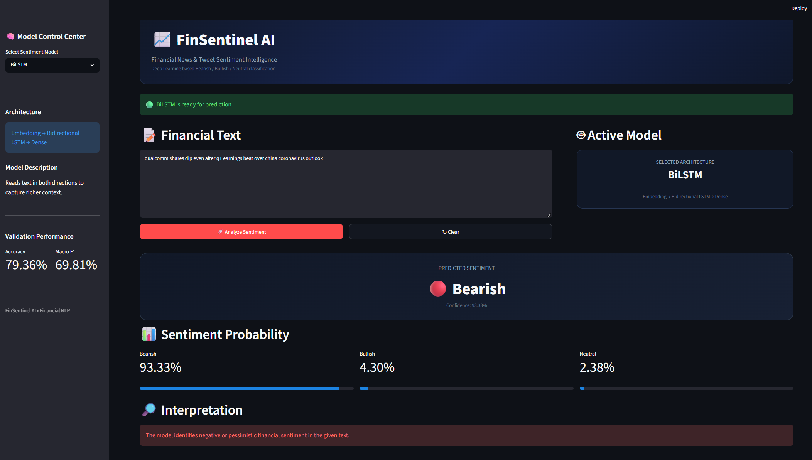

# Financial News Sentiment Prediction using Deep Learning

## 📌 Project Overview

**Financial News Sentiment Prediction** is an NLP and Deep Learning project designed to classify finance-related text into three sentiment categories:

- 🔴 **Bearish**
- 🟢 **Bullish**
- ⚪ **Neutral**


<a href="https://financial-news-sentiment-prediction-using-deep-learning-bert-o.streamlit.app/"> Live Demo </a>


The project uses Natural Language Processing (NLP), text preprocessing, tokenization, sequence padding, and Deep Learning models to automatically understand the sentiment of financial news/tweets.

Four Deep Learning models were implemented and compared:

1. Simple RNN
2. LSTM
3. GRU
4. Bidirectional LSTM (BiLSTM)

A **Streamlit web application** was developed to allow users to enter financial text and receive a real-time sentiment prediction along with probability scores.

---

# 🎯 Objectives

The main objectives of this project are:

- Perform NLP-based financial text classification.
- Clean and preprocess financial text data.
- Convert text into numerical sequences using a tokenizer.
- Apply padding to make input sequences equal in length.
- Train multiple Deep Learning models.
- Compare model performance using Accuracy and Macro F1-Score.
- Identify the best-performing model.
- Save trained models for deployment.
- Build an interactive Streamlit dashboard.
- Generate real-time sentiment predictions.

---

# 🏦 Domain

**Finance & FinTech**

Sentiment analysis is useful in financial applications because the sentiment of financial news and social media content can provide insights into market perception.

For example:

```text
"Company reports strong quarterly profit growth."
```

Prediction:

```text
Bullish
```

Example:

```text
"Company faces major losses and declining revenue."
```

Prediction:

```text
Bearish
```

Example:

```text
"The company announced its quarterly results today."
```

Prediction:

```text
Neutral
```

---

# 📊 Dataset

The project uses the **Twitter Financial News Sentiment Dataset**.

The dataset contains finance-related text documents with sentiment labels.

### Dataset Statistics

| Dataset | Records |
|---|---:|
| Total Dataset | 11,932 |
| Training Dataset | 9,938 |
| Validation Dataset | 2,486 |

### Target Classes

| Label | Meaning |
|---|---|
| Bearish | Negative financial sentiment |
| Bullish | Positive financial sentiment |
| Neutral | Neither positive nor negative |

---

# 🔄 Project Workflow

```text
Financial Text
      ↓
Data Loading
      ↓
Data Inspection
      ↓
Missing Value & Duplicate Check
      ↓
Text Cleaning
      ↓
Tokenization
      ↓
Sequence Conversion
      ↓
Padding
      ↓
Deep Learning Models
      ↓
Model Evaluation
      ↓
Best Model Selection
      ↓
Model Saving
      ↓
Streamlit Deployment
      ↓
Real-Time Sentiment Prediction
```

---

# 🧹 Data Preprocessing

The following preprocessing steps were performed.

## 1. Lowercasing

All text was converted to lowercase.

Example:

```text
"Company Reports Strong Growth"
```

becomes:

```text
"company reports strong growth"
```

---

## 2. Removing Special Characters

Special characters and unnecessary symbols were removed.

Example:

```text
"Company!!! profit @ 20%"
```

becomes:

```text
"company profit"
```

---

## 3. Removing Numbers

Numbers were removed where they were not required for sentiment classification.

---

## 4. Stopword Removal

Common English stopwords were removed to reduce unnecessary words.

Examples:

```text
the
is
a
an
of
to
```

Important negation words such as:

```text
not
no
never
neither
nor
```

were preserved because they can change sentiment meaning.

---

## 5. Tokenization

The cleaned text was converted into numerical sequences using the Keras tokenizer.

Example:

```text
"company profit increased"
```

could become:

```text
[25, 184, 76]
```

---

## 6. Padding

Different text sequences have different lengths.

Therefore, padding was applied to make every input sequence the same length.

Configuration:

```text
Maximum Vocabulary Size = 20,000
Maximum Sequence Length = 100
Padding = post
Truncating = post
```

---

# 🧠 Deep Learning Models

Four Deep Learning architectures were implemented.

---

## 1. Simple RNN

A Simple Recurrent Neural Network processes text sequentially and maintains information from previous words.

### Advantages

- Simple architecture
- Easy to understand
- Useful as a baseline

### Limitation

It can struggle with long-term dependencies because of the vanishing gradient problem.

---

## 2. LSTM

**Long Short-Term Memory (LSTM)** is an improved version of RNN.

It uses gates to control information flow:

- Forget Gate
- Input Gate
- Output Gate

This allows the model to remember important information for longer sequences.

---

## 3. GRU

**Gated Recurrent Unit (GRU)** is another recurrent architecture.

It is generally simpler than LSTM while still being capable of learning long-term dependencies.

GRU uses:

- Update Gate
- Reset Gate

---

## 4. BiLSTM

**Bidirectional LSTM** processes the text in both directions:

```text
Forward Direction
        ↓
Text → → → →

Backward Direction
        ↑
Text ← ← ← ←
```

This allows the model to use both previous and future contextual information.

BiLSTM performed the best among the baseline models in this project.

---

# 📈 Model Evaluation

The models were evaluated using:

### Accuracy

Accuracy measures the percentage of correctly classified samples.

```text
Accuracy = Correct Predictions / Total Predictions
```

---

### Macro F1-Score

Macro F1 calculates the F1-score independently for each class and then takes the average.

It is particularly useful when evaluating multi-class classification because it gives equal importance to each class.

---

### Confusion Matrix

A confusion matrix shows how many samples were correctly and incorrectly classified for each sentiment class.

---

# 🏆 Model Comparison

The following results were obtained on the validation dataset:

| Model | Accuracy | Macro F1 |
|---|---:|---:|
| Simple RNN | 65.58% | 26.40% |
| LSTM | 65.58% | 26.40% |
| GRU | 65.58% | 26.40% |
| **BiLSTM** | **79.36%** | **69.81%** |

---

# 🥇 Best Model

The **BiLSTM model** achieved the best performance.

### BiLSTM Results

```text
Accuracy: 79.36%

Macro F1-Score: 69.81%
```

Compared with the other baseline models, BiLSTM provided significantly better classification performance.

### Improvement

Accuracy improved from approximately:

```text
65.58% → 79.36%
```

Macro F1 improved from:

```text
26.40% → 69.81%
```

Therefore, **BiLSTM was selected as the best baseline Deep Learning model**.

---

# 💾 Model Saving

The trained models were saved in `.keras` format.

```text
models/
│
├── rnn_model.keras
├── lstm_model.keras
├── gru_model.keras
└── bilstm_model.keras
```

The tokenizer was also saved using Python pickle:

```text
tokenizer.pkl
```

The tokenizer is required during deployment because new user text must be converted into the same numerical representation used during model training.

---

# 🖥️ Streamlit Application

A Streamlit dashboard was developed for real-time prediction.

The application provides:

- Model selection
- Financial text input
- Sentiment prediction
- Sentiment probability
- Model comparison
- Validation performance
- Interactive dashboard

---

# 📱 Streamlit Features

## Model Selection

Users can select a model from the sidebar:

```text
Simple RNN
LSTM
GRU
BiLSTM
```

---

## Text Input

Users can enter financial news or financial text.

Example:

```text
Apple reports strong quarterly revenue growth and
increased investor confidence.
```

---

## Prediction

The application predicts one of:

```text
Bullish
Bearish
Neutral
```

---

## Probability Scores

The application also displays the probability for each class.

Example:

```text
Bullish   82.4%
Neutral   12.1%
Bearish    5.5%
```

---

# 📁 Project Structure

```text
Financial-Sentiment/
│
├── app.py
│
├── models/
│   ├── rnn_model.keras
│   ├── lstm_model.keras
│   ├── gru_model.keras
│   ├── bilstm_model.keras
│   ├── tokenizer.pkl
│   └── model_comparison.csv
│
├── data/
│   ├── train_clean.csv
│   └── valid_clean.csv
│
├── notebooks/
│   └── financial_sentiment.ipynb
│
├── requirements.txt
│
└── README.md
```

---

# ⚙️ Installation

## Step 1 — Clone the Repository

```bash
git clone <YOUR
